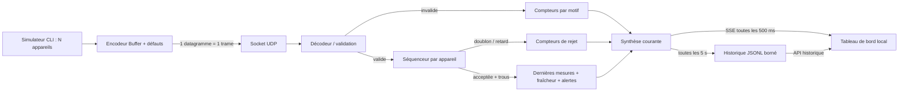

# PulseHub

Hub de télémétrie UDP pour une régie événementielle. Réception de PulseHub v1, suivi des appareils, détection des pertes et tableau de bord web local. Projet individuel réalisé pour le sujet Master Tech-Lead/CTO, avec assistance IA déclarée ci-dessous.


## Démarrer en moins de cinq minutes

Prérequis : **Node.js 22.15 ou supérieur**, npm et Git. Version utilisée pour la validation : Node 22.15.1, Windows 11. Aucune base de données, aucun compte externe, aucun secret et aucune dépendance applicative d’exécution. Les outils de développement sont verrouillés dans `package-lock.json`.

```sh
git clone https://github.com/sebgrtd/rattrapage.git
cd rattrapage
git checkout v1.0
npm ci
npm run hub
```

Ouvrir **http://127.0.0.1:3000**. Le hub sert lui-même l’interface : aucune commande front supplémentaire. Au démarrage, tous les compteurs de réception et de flotte sont à **zéro**. L’historique d’une précédente session reste accessible séparément.

Dans un second terminal, depuis le même dossier :

```sh
npm run simulator
```

Les valeurs évoluent : 50 appareils, 20 Hz chacun, soit 1 000 trames/s nominales. Les appareils sont identifiés `PH-001` à `PH-050`.

Pour démontrer tous les défauts, arrêter le simulateur **et le hub** avec `Ctrl+C`, redémarrer le hub, puis lancer dans le second terminal :

```sh
npm run demo
```

Le redémarrage du hub est nécessaire entre deux sessions de simulateur : le simulateur remet ses compteurs de séquence à zéro, et l’inférence automatique d’un redémarrage matériel est volontairement hors périmètre.

La démo injecte 3 % de checksums invalides, 4 % de duplications, 4 % de désordres ; les huit premiers appareils sur 50 présentent des valeurs anormales continues. L’appareil 7 s’arrête après 8 s et devient hors ligne 3 s plus tard. Les autres appareils restent actifs. Les taux de défauts sont des probabilités par opportunité, pas des quotas exacts ; les défauts peuvent se cumuler.

Pour vérifier le projet :

```sh
npm test
npm run check
```

`check` exécute lint, vérification TypeScript stricte, tests unitaires/intégration et compilation. Pour lancer le code compilé : `npm run build`, puis `node dist/hub.js` ou `node dist/simulator.js`. Les dossiers `config/` et `public/` restent nécessaires à côté de `dist/`.

## Commandes et configuration

```sh
npm run hub -- --udp-port 9001 --http-port 3001
npm run hub -- --config config/local.json
npm run simulator -- --port 9001 --devices 100 --hz 10 --duration 30
npm run simulator -- --checksum-rate 0.1 --duplicate-rate 0.1 --reorder-rate 0.1 --anomaly-rate 0.2 --stop-device 7 --stop-after 8 --seed 42
npm run simulator -- --help
```

**PowerShell :** pour les commandes avec options, utiliser `npm.cmd run ... -- ...` : certaines versions de `npm.ps1` consomment le séparateur `--`. Les commandes sans options (`npm run hub`, `npm run demo`, `npm test`) fonctionnent directement.

Le hub charge [config/default.json](config/default.json), puis les champs du fichier `--config`, puis les éventuelles options de port. Un fichier personnalisé peut être partiel, par exemple :

```json
{
  "udpPort": 9001,
  "httpPort": 3001,
  "offlineMs": 5000,
  "staleMs": 2000,
  "historyFile": "data/concert.jsonl"
}
```

| Paramètre hub | Défaut | Rôle |
| --- | --- | --- |
| `udpHost`, `udpPort` | `127.0.0.1`, `9000` | Écoute UDP IPv4 ; utiliser `0.0.0.0` pour recevoir sur le LAN |
| `httpHost`, `httpPort` | `127.0.0.1`, `3000` | Interface et API locales |
| `refreshMs` | 500 | Diffusion de la synthèse par SSE, soit 2 Hz |
| `offlineMs` | 3000 | Âge maximal de la dernière trame acceptée |
| `staleMs` | 2000 | Âge maximal de chaque mesure ; inférieur ou égal à `offlineMs` |
| `rateWindowMs` | 2000 | Fenêtre du débit, divisée en 20 compartiments temporels |
| `maxDevices` | 4096 | Borne du registre ; nouvelles identités excédentaires comptées et écartées |
| `maxClients` | 20 | Borne des connexions SSE simultanées |
| `historyFile` | `data/history.jsonl` | Historique local ; chaîne vide pour désactiver |
| `historyIntervalMs` | 5000 | Intervalle entre instantanés persistés |
| `historyMaxBytes` | 10485760 | Taille maximale par fichier, avec une archive `.1` |
| `alerts` | 3 règles | Limites physiques et durée minimale d’anomalie |

Les règles utilisent les **unités entières du protocole**. Par défaut : température hors de [-20 ; 70] °C pendant 3 s ; tension hors de [21 ; 26] V ou courant hors de [0 ; 8] A pendant 500 ms. Les bornes sont inclusives, les dépassements stricts. Cette installation simulée fonctionne en **24 V continu**, car un `int16` signé en millivolts ne peut représenter que -32,768 à 32,767 V. Une nouvelle règle sur une métrique existante s’ajoute au JSON sans modifier le moteur. Le tableau `alerts` personnalisé remplace entièrement celui par défaut. Les erreurs de configuration arrêtent le démarrage avec un message explicite.

| Option simulateur | Défaut | Rôle |
| --- | --- | --- |
| `--host`, `--port` | `127.0.0.1`, `9000` | Destination UDP |
| `--devices`, `--hz` | 50, 20 | Nombre d’appareils et fréquence par appareil |
| `--duration` | 0 | Durée en secondes ; 0 = jusqu’à `Ctrl+C` |
| `--seed` | 42 | Générateur pseudo-aléatoire reproductible pour les valeurs et défauts |
| `--checksum-rate` | 0 | Probabilité de corruption du checksum |
| `--duplicate-rate` | 0 | Probabilité d’émission d’une copie supplémentaire |
| `--reorder-rate` | 0 | Probabilité de retenir une trame jusqu’après la suivante du même appareil |
| `--anomaly-rate` | 0 | Fraction des appareils dont les valeurs restent anormales ; arrondi supérieur |
| `--stop-device`, `--stop-after` | 0, 8 | Identifiant à arrêter et délai ; 0 désactive l’arrêt |
| `--heartbeat-every` | 20 | Une trame sur 20 devient un heartbeat ; 0 désactive cette substitution |

Les heartbeats **remplacent** des télémétries : ils n’augmentent pas le débit nominal. Une séquence commune couvre les deux types. La minuterie cible des échéances absolues ; elle évite les rattrapages massifs et compte les cycles ignorés lorsque les envois précédents ne sont pas terminés. La graine rend les tirages reproductibles, pas le timing de l’OS.

## Architecture et parcours d’une trame



| Fichier | Responsabilité |
| --- | --- |
| `src/protocol.ts` | Décodage et encodage manuels avec `Buffer` |
| `src/sequence.ts` | Ordre des numéros uint32 et calcul des trous |
| `src/fleet.ts` | État métier, compteurs, fraîcheur, alertes et synthèse |
| `src/config.ts` | Fusion et validation de la configuration |
| `src/server.ts` | Adaptateurs UDP, HTTP, SSE et cycle de vie |
| `src/history.ts` | Écriture, rotation et lecture des instantanés |
| `src/hub.ts` | Point d’entrée CLI du hub |
| `src/simulator.ts` | Appareils virtuels et injection des défauts |
| `public/` | Affichage, filtres, recherche et consultation de l’historique |

Le décodeur valide la longueur avant toute lecture, puis magic, version, type, longueur exacte, XOR, identifiant et mesures. Les types inconnus, appareils 0, métriques inconnues/répétées et heartbeats avec mesures sont rejetés. Une télémétrie sans mesure est acceptée, le sujet ne l’interdisant pas. Toutes les valeurs `int16` valides sont acceptées structurellement : les anomalies physiques relèvent de la synthèse, pas du décodeur. La trame du sujet `50 48 01 02 00 07 00 00 00 01 00 00 03 E8 00 F6` constitue le premier test du fichier dédié au protocole.

## Synthèse et choix de visualisation

La régie doit décider rapidement **où intervenir** et **si les chiffres sont fiables**.

- **Opérationnel** : trame récente, trois mesures fraîches et aucune anomalie en cours.
- **Observation** : valeur anormale dont la durée minimale n’est pas encore atteinte.
- **Alerte** : dépassement continu observé pendant la durée configurée. Les valeurs normales réarment immédiatement la règle.
- **Mesures périmées** : au moins une grandeur manque ou n’a pas été actualisée ; un heartbeat conserve la présence mais ne rafraîchit pas les mesures.
- **Hors ligne** : aucune nouvelle trame acceptée depuis le délai configuré ; les anciennes mesures restent visibles en grisé.

Les états sont exclusifs, dans l’ordre de priorité : hors ligne, alerte, mesures périmées, observation, opérationnel. Le bandeau « à surveiller » additionne alerte, observation et périmé. Le panneau d’attention présente les 20 appareils les plus prioritaires ; la table permet de consulter toute la flotte, chercher un identifiant et filtrer les états. Couleurs **et libellés** portent le sens. L’interface est responsive ; sur mobile le tableau défile horizontalement dans son conteneur.

Le débit mesure les datagrammes réellement reçus, invalides incluses, sur une fenêtre glissante approximative ; la précision de bord est limitée à un compartiment (100 ms par défaut). Les compteurs sont cumulatifs pour la session. Le graphe conserve seulement les 60 derniers échantillons vus par ce navigateur, et démarre vide après un rechargement.

La réception est marquée « défauts observés » tant que des invalides, trous ou rejets de capacité ont été comptés pendant la session ; ce libellé ne prétend pas décrire exclusivement les dernières secondes. Une perte de connexion au hub affiche **données figées** : le navigateur ne continue pas à présenter une réception en direct.

### Séquencement et comptage des pertes

Pour un appareil, `delta = (seq - lastSeq) >>> 0` :

- première trame : acceptée, sans inventer de pertes avant l’observation ;
- `delta = 0` : doublon du dernier numéro accepté ;
- `0 < delta < 2³¹` : nouvelle trame, `delta - 1` trous supplémentaires ;
- `delta >= 2³¹` : retard ou ambiguïté, trame écartée.

Le passage de `0xffffffff` à `0` fonctionne. Les copies d’anciens numéros sont classées **retards**, faute de conserver un historique illimité des séquences. Elles sont bien écartées. Les rejets ne rafraîchissent ni la présence ni les mesures. Les appareils sont indépendants.

Les trous sont des **pertes estimées à l’instant d’acceptation**, non une mesure exacte des pertes physiques. Un paquet retardataire comblant un trou reste rejeté, sans décrémenter le compteur. Une corruption peut être comptée comme invalide puis produire un trou au paquet suivant. Aucun trou n’est détectable après la dernière trame d’un appareil silencieux. Pas de retransmission UDP ni de fenêtre de réordonnancement : priorité à l’état le plus récent.

Identité de comptage vérifiable : `reçues = acceptées + invalides + doublons + retards + rejets de capacité`. `perdues` est une estimation supplémentaire, jamais ajoutée aux reçues. Pourcentages : `invalides / reçues` ; `perdues / (acceptées + perdues)` ; dénominateur nul = 0.

### Historique

Cliquer « Consulter l’historique », puis sélectionner une date. Le tableau, les alertes et les compteurs affichent cet instantané ; « Revenir au direct » restaure le dernier état reçu. Les données survivent au redémarrage du hub. L’API `/api/history` fournit les 120 derniers instantanés des deux fichiers.

La persistance enregistre une synthèse toutes les 5 s et à l’arrêt propre. Elle conserve au maximum deux fichiers de 10 Mio chacun ; ce n’est pas un archivage intégral de concert. Une écriture peut être ignorée si la précédente n’est pas terminée ; les erreurs, succès et omissions sont visibles dans le pied de page ou le bandeau. Une ligne finale incomplète est ignorée à la lecture. Les fichiers `data/` ne sont pas versionnés. Exporter ces fichiers avant un événement suivant si une conservation longue est nécessaire.

## Principes de conception démontrés

Les liens ci-dessous sont des **permaliens sur un commit précis**, générés à partir du code réellement versionné avec `npm run permalinks`.

<!-- PRINCIPLES:START -->
| Principe | Preuve concrète | Code immuable |
| --- | --- | --- |
| KISS / traitement explicite | Le décodeur valide chaque champ avec Buffer et retourne un résultat typé ; aucune couche de parsing générique. | [src/protocol.ts, lignes 22–48](https://github.com/sebgrtd/rattrapage/blob/a2c3d776a57741a61cfc7806db7b635871713c51/src/protocol.ts#L22-L48) |
| Séparation des responsabilités | Le séquenceur décide uniquement de l’ordre et des trous, indépendamment du réseau, des alertes et de l’affichage. | [src/sequence.ts, lignes 3–13](https://github.com/sebgrtd/rattrapage/blob/a2c3d776a57741a61cfc7806db7b635871713c51/src/sequence.ts#L3-L13) |
| Injection de dépendance | Fleet reçoit sa configuration et son horloge ; les tests avancent le temps sans attendre. | [src/fleet.ts, lignes 11–32](https://github.com/sebgrtd/rattrapage/blob/a2c3d776a57741a61cfc7806db7b635871713c51/src/fleet.ts#L11-L32) |
| Règles pilotées par les données | Un même moteur évalue les limites et durées de chaque règle JSON ; ajouter une règle ne demande pas de nouvelle condition spécifique. | [src/fleet.ts, lignes 50–61](https://github.com/sebgrtd/rattrapage/blob/a2c3d776a57741a61cfc7806db7b635871713c51/src/fleet.ts#L50-L61) |
| Frontière réseau / métier | Les adaptateurs UDP et HTTP délèguent le traitement métier à Fleet et diffusent des instantanés. | [src/server.ts, lignes 9–85](https://github.com/sebgrtd/rattrapage/blob/a2c3d776a57741a61cfc7806db7b635871713c51/src/server.ts#L9-L85) |
<!-- PRINCIPLES:END -->

Pas de revendication de conformité intégrale à SOLID : l’objectif est une séparation utile et explicable, dans la contrainte d’une journée. Le registre contient uniquement le dernier état par appareil ; le débit utilise un nombre borné de compartiments. Un client SSE lent est déconnecté plutôt que de laisser grossir indéfiniment sa file de sortie.

## Choix et compromis

| Choix retenu | Motif | Option écartée |
| --- | --- | --- |
| TypeScript strict + modules natifs Node | Respect du sujet, typage explicite, installation courte | NestJS : structure supplémentaire peu utile à ce périmètre |
| `Buffer` écrit à la main | Contrôle des offsets et validation explicable | Bibliothèque de parsing binaire : interdite |
| État en mémoire et règles explicites | Coût faible par trame et testabilité | Bibliothèque de synthèse : interdite |
| HTTP + Server-Sent Events | Flux serveur → navigateur suffisant, reconnexion native | WebSocket : bidirectionnalité inutile |
| HTML/CSS/JavaScript sans framework | Tableau de bord utilisable sans build front | React et bundler : dépendances supplémentaires pour une seule vue |
| `node:test`, horloge injectée | Aucun framework de test supplémentaire, tests sans attentes pour le métier | Timers réels dans les tests unitaires : lents et fragiles |
| JSONL avec rotation | Consultation après arrêt, format inspectable, pas de service à installer | Base de séries temporelles : hors contrainte de temps |

## Qualité et validation

Les 21 tests couvrent les trames de référence, les limites des entiers signés/non signés, les erreurs de structure, 10 000 datagrammes arbitraires déterministes, le séquencement, le wrap uint32, les seuils temporels, la fraîcheur par métrique, les heartbeats, l’arrêt d’un appareil, la capacité du registre, l’historique et sa rotation, les ports occupés, les API HTTP/SSE (dont la diffusion de grandes synthèses sans reconnexion) et les **cinq défauts du simulateur sur de vrais sockets UDP**.

La CI exécute `npm ci` puis `npm run check` à chaque push et pull request, sur Linux et Windows avec Node 22. Les contrôles manuels complémentaires sont décrits dans [docs/acceptation.md](docs/acceptation.md). L’interface a aussi été contrôlée avec un navigateur automatisé sur desktop et mobile ; la capture ci-dessus est issue de la vraie démo, pas d’un jeu de données factice.

### Mesure de débit

```sh
npm run benchmark
npm run benchmark -- --seconds 10 --rates 1000,5000,10000,20000,40000,80000,160000
```

Sous PowerShell : remplacer `npm` par `npm.cmd` pour la seconde commande. Le script écrit [docs/benchmark.json](docs/benchmark.json), incluant date, CPU, OS, version Node et résultats bruts. Il utilise UDP sur loopback, un simulateur dans un processus séparé, un hub neuf par palier, des consultations HTTP à 2 Hz et la persistance activée. La fréquence reste 20 Hz ; le nombre d’appareils augmente. Pour ces mesures uniquement, la capacité du registre suit le nombre d’appareils.

Chaque palier dure 10 s ; 300 ms de vidage sont laissées avant le comptage final. Sont rapportés : envois effectivement réussis, datagrammes reçus et acceptés, débit d’émission mesuré, trous, erreurs d’envoi, cycles ignorés, RSS et latence HTTP maximales échantillonnées. Un palier est déclaré soutenu si au moins 99,9 % des envois arrivent, si le débit émis atteint 95 % de la cible et si toutes les trames reçues sont acceptées sans erreur d’envoi. Le compteur émis permet de voir aussi les pertes en fin de flux, invisibles au seul séquenceur.

<!-- BENCHMARK:START -->
Mesure du 2026-10-30T08:46:34.120Z, sur AMD Ryzen 9 5900HS with Radeon Graphics, win32 10.0.26200, Node v22.15.1. Plus haut palier validé : **40000 trames/s demandées** ; le palier 80000 échoue aux critères. Cette mesure porte sur la chaîne simulée complète ; la saturation du simulateur ne permet pas d’isoler le plafond du hub seul.

| Cible /s | Émis /s mesurés | Livraison | Trous | RSS max Mio | HTTP max ms | Soutenu |
| --- | --- | --- | --- | --- | --- | --- |
| 1000 | 1000 | 100 % | 0 | 80 | 56 | Oui |
| 5000 | 4994 | 100 % | 0 | 78 | 20 | Oui |
| 10000 | 9998 | 100 % | 0 | 86 | 9 | Oui |
| 20000 | 19983 | 100 % | 0 | 102 | 16 | Oui |
| 40000 | 39989 | 100 % | 0 | 106 | 21 | Oui |
| 80000 | 67657 | 99.83 % | 1155 | 117 | 42 | Non |
| 160000 | 69115 | 94.301 % | 39668 | 158 | 78 | Non |
<!-- BENCHMARK:END -->

Ces valeurs décrivent cette machine et cette charge courte, pas un SLA ni une certification matérielle. La RSS du processus peut inclure des allocations des paliers précédents et la mesure HTTP inclut le client de test. Le benchmark ne mesure pas le rendu de milliers de lignes dans un navigateur ni une liaison Wi-Fi réelle. Refaire des essais longs sur le réseau et le matériel du spectacle avant exploitation.

## Limites connues et suite logique

- Pas d’identifiant de session dans PulseHub v1 : un redémarrage matériel peut être confondu avec un paquet ancien. `uptimeMs` est affichable via l’API mais n’est pas utilisé pour réinitialiser automatiquement le séquenceur. Redémarrer le hub pour une nouvelle session de simulateur. Le wrap uint32 normal est pris en charge, le redémarrage automatique ne l’est pas.
- La comparaison sérielle suppose moins de 2³¹ séquences d’écart entre observations. Au-delà, l’ordre est ambigu.
- L’état initial est vide, sans inventaire attendu : un appareil qui n’a jamais émis ne peut pas être déclaré absent. Après détection, les appareils restent au registre jusqu’au redémarrage, dans la limite configurée.
- Une valeur anormale est présumée continue entre mesures fraîches. Une absence de mesure pendant `staleMs` annule la continuité ; le prochain dépassement repart de zéro. Le hub ne peut pas connaître les fluctuations entre deux émissions.
- Un XOR détecte certaines corruptions, pas une falsification ; UDP n’apporte ni authentification ni garantie de livraison. Les identifiants peuvent entrer en collision ou être usurpés. L’écoute est locale par défaut ; ouvrir au LAN requiert un réseau de régie de confiance. Pas de TLS, comptes utilisateurs ou exposition Internet.
- Pas de reprise automatique après une erreur définitive du socket, ni de déploiement haute disponibilité. Les erreurs sont comptées ; un redémarrage du processus peut être nécessaire.
- L’historique est périodique et borné, sans journal de toutes les trames ni reprise de l’état métier. Un arrêt brutal peut perdre la dernière écriture.
- Règles d’alerte configurables, mais pas de pipeline générique de filtres et agrégations à plugins. Ce bonus complet n’est pas revendiqué.
- Pas de contrôle des équipements, de notifications externes, de tests de charge multi-machines ou de validation utilisateur sur un vrai spectacle.

Bonus réalisés : alertes avec durée, persistance consultable, wrap de séquence, mesure de débit documentée, CI. Les limites ci-dessus précisent la portée exacte.

## Git et remise

Le dépôt a été créé spécifiquement pour ce projet. L’historique contient des commits de progression réels : protocole, métier, application, validation et documentation. Aucun historique antidaté, aucun autre projet repris. `.gitignore` exclut dépendances, compilation, données de test et secrets. Le tag annoté `v1.0` identifie le rendu ; les workflows s’appliquent également au push de ce tag.

```sh
git log --oneline --decorate
git show v1.0 --stat
```

Lien à remettre : **https://github.com/sebgrtd/rattrapage** ; version évaluée : **v1.0**. L’envoi du lien à l’enseignant reste à effectuer par l’étudiant, selon les modalités et l’heure limite de son établissement.

## Usage de l’IA et soutenance

**OpenAI Codex a été utilisé** pour lire le sujet, proposer l’architecture, générer et corriger le code, les tests, l’interface, la documentation et les scripts de validation, puis exécuter les contrôles. L’assistance couvre une part significative du livrable ; elle ne doit pas être présentée comme une simple correction orthographique. Aucun autre participant humain ni sous-agent n’a été sollicité pour ce travail.

Le sujet autorise l’IA mais exige de pouvoir expliquer chaque ligne livrée. Le [guide de soutenance](docs/soutenance.md) fournit un parcours de 20 minutes, des explications des choix et des questions de vérification. Il faut lire, exécuter et comprendre le projet avant de le défendre.
