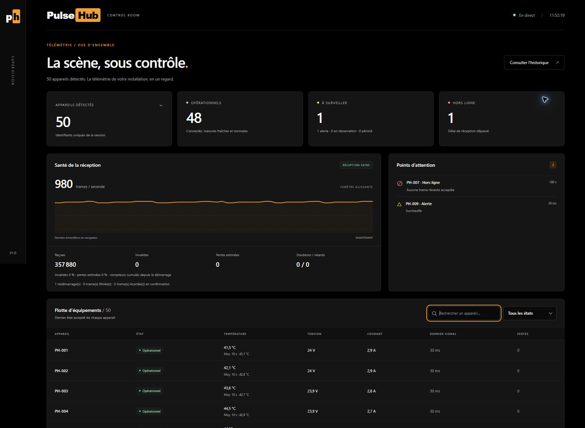
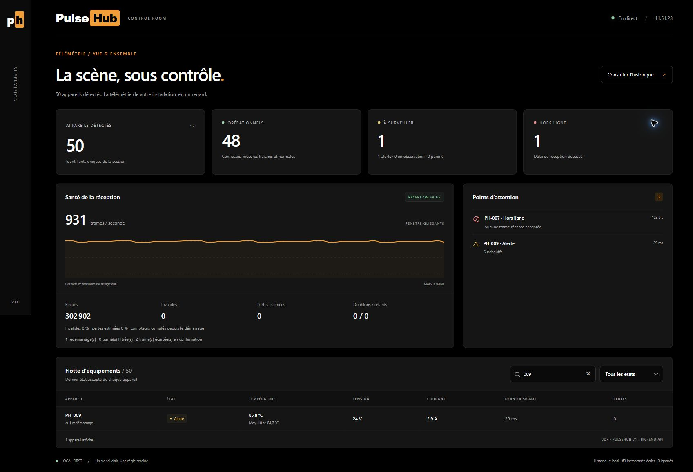
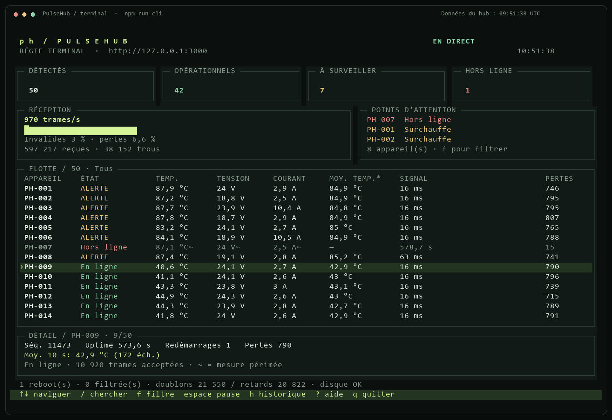
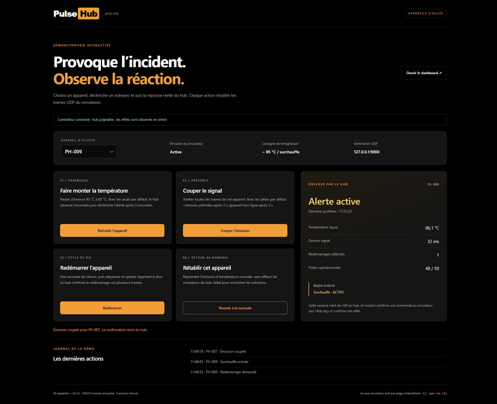
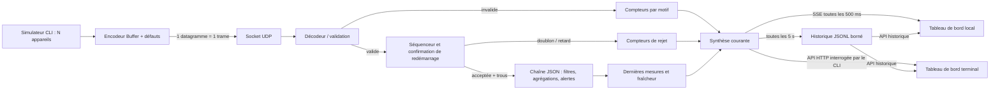

# PulseHub

Hub de télémétrie UDP pour une régie événementielle. Réception de PulseHub v1, suivi des appareils, détection des pertes et tableaux de bord web et terminal locaux. Projet individuel réalisé pour le sujet Master Tech-Lead/CTO, avec assistance IA déclarée ci-dessous.



Accès rapide : [démarrage](#démarrer-en-moins-de-cinq-minutes) · [interface web](#interface-web) · [interface CLI](#tableau-de-bord-terminal) · [démo interactive](#déclencher-les-incidents-à-la-demande) · [configuration](#commandes-et-configuration).

## Démarrer en moins de cinq minutes

Prérequis : **Node.js 22.15 ou supérieur**, npm et Git. Version utilisée pour la validation : Node 22.15.1, Windows 11. Aucune base de données, aucun compte externe, aucun secret et aucune dépendance applicative d’exécution. Les outils de développement sont verrouillés dans `package-lock.json`.

```sh
git clone https://github.com/sebgrtd/rattrapage.git
cd rattrapage
git checkout v1.0
npm ci
npm run hub
```

Ouvrir **http://127.0.0.1:3000**. Le hub sert lui-même l’interface : aucune commande front supplémentaire. Au démarrage, tous les compteurs de réception et de flotte sont à **zéro**. L’historique d’une précédente session reste accessible séparément.

Le tag **`v1.0`** contient le rendu complet : hub, simulateurs automatique et interactif, interfaces web et CLI, bonus, tests, guides et captures. `main` contient également cette version ; utiliser le tag pour reproduire exactement le rendu évalué.

Dans un second terminal, depuis le même dossier :

```sh
npm run simulator
```

Les valeurs évoluent : 50 appareils, 20 Hz chacun, soit 1 000 trames/s nominales. Les appareils sont identifiés `PH-001` à `PH-050`.

Pour démontrer les défauts, arrêter le simulateur avec `Ctrl+C`, puis lancer dans le second terminal :

```sh
npm run demo
```

Le hub peut rester lancé entre deux sessions : il détecte le retour de la séquence et de l’uptime au début, puis confirme le redémarrage sur trois trames cohérentes. Pour retrouver tous les compteurs à zéro, redémarrer le hub. Les seuils et limites de cette détection sont décrits dans [docs/pipeline.md](docs/pipeline.md).

La démo injecte 3 % de checksums invalides, 4 % de duplications, 4 % de désordres ; les huit premiers appareils sur 50 présentent des valeurs anormales continues. L’appareil 7 s’arrête après 8 s et devient hors ligne 3 s plus tard. L’appareil 9 redémarre après 12 s, avec une seconde de silence : son compteur de redémarrages passe à 1 et ses agrégats repartent de zéro. Les autres appareils restent actifs. Les taux de défauts sont des probabilités par opportunité, pas des quotas exacts ; les défauts peuvent se cumuler.

Pour observer uniquement un redémarrage, lancer `npm run demo:restart` : l’appareil 7 redémarre après 5 s et une seconde de silence.

Pour vérifier le projet :

```sh
npm test
npm run check
```

`check` exécute lint, vérification TypeScript stricte, tests unitaires/intégration et compilation. Pour lancer le code compilé : `npm run build`, puis `node dist/hub.js` ou `node dist/simulator.js`. Les dossiers `config/` et `public/` restent nécessaires à côté de `dist/`.

## Utiliser les interfaces

Les deux interfaces affichent **les données du même hub** et peuvent être ouvertes simultanément. Dans la démo, les 50 appareils sont simulés : ils envoient de vraies trames UDP sur la machine locale. Le hub les valide, calcule les états et expose la synthèse ; les interfaces ne génèrent pas les mesures. Il n’y a pas de recherche automatique d’appareils sur le réseau.

### Interface web

1. Lancer `npm run hub`, puis `npm run demo` dans un second terminal, depuis le dossier du projet. Utiliser `npm run simulator` à la place de `demo` pour un flux sans défauts injectés.
2. Ouvrir **http://127.0.0.1:3000**. Le hub fournit directement la page web, sans serveur front séparé.
3. Lire le bandeau **En direct** : le navigateur reçoit une synthèse par SSE toutes les 500 ms par défaut. En cas de coupure, il indique **Déconnecté · données figées** et tente de se reconnecter.

La capture en tête de ce README montre la démo interactive avec PH-009 en surchauffe et PH-007 hors ligne. Les chiffres varient pendant l’exécution. L’identité web associe noir `#000000`, orange `#ff9900` et blanc, avec « Hub » en cartouche orange. Les états gardent leurs couleurs et libellés dédiés pour distinguer fonctionnement normal, alerte et coupure.

| Zone à l’écran | Comment la lire ou l’utiliser |
| --- | --- |
| **Appareils détectés / Opérationnels / À surveiller / Hors ligne** | Résumé de toute la flotte. « À surveiller » regroupe les alertes actives, les anomalies encore en observation et les mesures périmées. |
| **Santé de la réception** | Débit UDP reçu, graphe récent, trames invalides, pertes estimées et doublons/retards. Les compteurs restent cumulés depuis le démarrage du hub ; les pertes sont des trous de séquence estimés. |
| **Points d’attention** | Appareils nécessitant une vérification, avec les hors-ligne en priorité et le motif des alertes. |
| **Flotte d’équipements** | Dernière température en °C, tension en V, courant en A, âge du signal et pertes de chaque appareil. Une ancienne mesure reste visible en grisé. Les agrégats configurés apparaissent sous les mesures, les redémarrages sous l’identifiant. |
| **Rechercher un appareil / filtre d’état** | Saisir `009` ou `PH-009` pour isoler un appareil, ou choisir « À surveiller », « Opérationnels » ou « Hors ligne ». Ces filtres concernent la table ; les compteurs du haut restent ceux de la flotte entière. |
| **Consulter l’historique** | Ouvrir le panneau, puis choisir une date dans « Instantané enregistré ». Le bandeau passe en **Lecture historique** ; table, compteurs et alertes affichent l’instant choisi. Cliquer **Revenir au direct** pour reprendre le suivi courant. |

**Exemple : retrouver un appareil redémarré.** Après 13 secondes de démo, rechercher `009`. La ligne PH-009 indique un redémarrage et une moyenne de température recalculée depuis sa nouvelle session. Dans la même démo, PH-007 devient hors ligne après son arrêt. Effacer la recherche pour retrouver toute la flotte.



L’historique est enregistré toutes les 5 secondes par défaut : patienter si aucun instantané n’est encore disponible. Consulter l’historique ne suspend pas la réception du hub. Sur un petit écran, faire défiler le tableau horizontalement pour accéder à toutes les colonnes.

**Composants personnalisés.** Les menus d’état, d’historique et d’appareil utilisent le même composant, sans menu système. Ouvrir avec un clic, `Entrée`, `Espace` ou `↓`, parcourir avec `↑` / `↓` (`Début` / `Fin` pour les extrémités), puis valider avec `Entrée`. `Échap` annule et rend le focus au bouton ; `Tab` ferme le menu et poursuit la navigation. Un clic à l’extérieur ferme aussi le menu. Les listes longues proposent une recherche : saisir `009` dans l’atelier ou une heure dans l’historique. La croix de la recherche de flotte efface le filtre. Survoler une mesure ou sa moyenne affiche une infobulle personnalisée avec son âge ou sa fenêtre d’agrégation.

Les composants partagés sont dans `public/ui.js` et `public/ui.css`, servis par les deux interfaces web. Les éléments `select` masqués conservent les valeurs et événements utilisés par les applications ; les boutons, listes et champs visibles portent les rôles et états ARIA. Sans JavaScript, le suivi en direct et les commandes ne fonctionnent pas.

### Tableau de bord terminal

Avec le hub déjà lancé, ouvrir un terminal supplémentaire et lancer **`npm run cli`**. Le CLI reprend la flotte, le débit, les alertes et les agrégations du même serveur, avec navigation au clavier, recherche, filtres, pause et historique.

```sh
npm run cli
```

Préférer une fenêtre de **130 × 42 caractères**. Les cartes et le graphe résument la flotte ; la table se parcourt au clavier et le panneau du bas affiche les détails de l’appareil sélectionné : séquence, uptime, redémarrages, agrégations et alertes. Le CLI interroge `/api/state`, puis attend 500 ms avant la prochaine requête. Il retrouve automatiquement le hub après une coupure.

| Touche | Action |
| --- | --- |
| `↑` / `↓` | Sélectionner un appareil et lire son détail en bas |
| `Page précédente` / `Page suivante` ou `p` / `n` | Parcourir les pages de la flotte |
| `/`, puis `009`, puis `Entrée` | Rechercher PH-009 ; `Échap` efface la recherche hors saisie |
| `f` | Passer de tous les appareils aux états à surveiller, hors ligne ou opérationnels |
| `Espace` | Figer / reprendre l’affichage ; le hub continue de recevoir |
| `h` | Ouvrir l’historique / revenir au direct |
| `←` / `→` ou `[` / `]` | Parcourir les instantanés historiques |
| `?` | Afficher / masquer l’aide |
| `q` / `Ctrl+C` | Quitter le CLI, sans arrêter le hub ni le simulateur |

**EN DIRECT**, **PAUSE / DONNÉES FIGÉES**, **HISTORIQUE** et **HUB DÉCONNECTÉ** distinguent les modes. `~` signale une mesure périmée ; `—` indique une valeur indisponible. La colonne « MOY. TEMP. » affiche la première moyenne de température configurée, dont le libellé et le nombre d’échantillons sont précisés dans le détail.

Le [guide terminal](docs/terminal.md) détaille les raccourcis, les options, la reconnexion et la sortie texte `--once`.



Cet aperçu est exporté par le même moteur de rendu que le CLI, avec les données de la démo locale au moment de la capture. Les deux images web sont des captures du navigateur. Elles ne représentent pas des appareils physiques connectés.

Pour produire un instantané texte sans interaction : `npm.cmd run cli -- --once --no-color`. Pour utiliser un autre hub : `npm.cmd run cli -- --url http://127.0.0.1:3010`. Le CLI est inclus dans le tag de rendu `v1.0`.

### Déclencher les incidents à la demande

Pour la soutenance, **`npm run demo:interactive`** lance un simulateur contrôlable depuis **http://127.0.0.1:3100**. Garder le hub lancé sur le port 3000. Arrêter d’abord tout autre simulateur utilisant les mêmes identifiants ; pour des compteurs à zéro, redémarrer également le hub.

Choisir un appareil puis utiliser **Déclencher une surchauffe**, **Couper l’émission**, **Redémarrer** ou **Revenir à la normale**. Le panneau affiche la consigne du simulateur et l’état réellement observé par le hub. Les effets apparaissent aussi dans le dashboard web et le CLI : les commandes produisent de vraies trames UDP, sans écrire directement dans la synthèse.



Le [guide de démo interactive](docs/demo-interactive.md) donne un parcours de soutenance, les délais attendus, les options et les limites. Cette démo démarre nominale ; `npm run demo` conserve les défauts automatiques de corruption, duplication et désordre.

## Commandes et configuration

```sh
npm run hub -- --udp-port 9001 --http-port 3001
npm run hub -- --config config/local.json
npm run simulator -- --port 9001 --devices 100 --hz 10 --duration 30
npm run simulator -- --checksum-rate 0.1 --duplicate-rate 0.1 --reorder-rate 0.1 --anomaly-rate 0.2 --stop-device 7 --stop-after 8 --seed 42
npm run simulator -- --help
```

**PowerShell :** pour les commandes avec options, utiliser `npm.cmd run ... -- ...` : certaines versions de `npm.ps1` consomment le séparateur `--`. Les commandes sans options (`npm run hub`, `npm run demo`, `npm test`) fonctionnent directement.

Le hub charge [config/default.json](config/default.json), puis les champs du fichier `--config`, puis les éventuelles options de port. Un fichier personnalisé peut être partiel, par exemple :

```json
{
  "udpPort": 9001,
  "httpPort": 3001,
  "offlineMs": 5000,
  "staleMs": 2000,
  "historyFile": "data/concert.jsonl"
}
```

| Paramètre hub | Défaut | Rôle |
| --- | --- | --- |
| `udpHost`, `udpPort` | `127.0.0.1`, `9000` | Écoute UDP IPv4 ; utiliser `0.0.0.0` pour recevoir sur le LAN |
| `httpHost`, `httpPort` | `127.0.0.1`, `3000` | Interface et API locales |
| `refreshMs` | 500 | Diffusion de la synthèse par SSE, soit 2 Hz |
| `offlineMs` | 3000 | Âge maximal de la dernière trame acceptée |
| `staleMs` | 2000 | Âge maximal de chaque mesure ; inférieur ou égal à `offlineMs` |
| `rateWindowMs` | 2000 | Fenêtre du débit, divisée en 20 compartiments temporels |
| `maxDevices` | 4096 | Borne du registre ; nouvelles identités excédentaires comptées et écartées |
| `maxClients` | 20 | Borne des connexions SSE simultanées |
| `historyFile` | `data/history.jsonl` | Historique local ; chaîne vide pour désactiver |
| `historyIntervalMs` | 5000 | Intervalle entre instantanés persistés |
| `historyMaxBytes` | 10485760 | Taille maximale par fichier, avec une archive `.1` |
| `alerts` | 3 règles | Limites physiques et durée minimale d’anomalie |
| `restart` | 3 trames de confirmation | Détection configurable des remises à zéro ; voir [les paramètres](docs/pipeline.md#détection-de-redémarrage) |
| `pipeline` | filtre → moyenne → alertes | Liste ordonnée et extensible des traitements |

Les règles utilisent les **unités entières du protocole**. Par défaut : température hors de [-20 ; 70] °C pendant 3 s ; tension hors de [21 ; 26] V ou courant hors de [0 ; 8] A pendant 500 ms. Les bornes sont inclusives, les dépassements stricts. Cette installation simulée fonctionne en **24 V continu**, car un `int16` signé en millivolts ne peut représenter que -32,768 à 32,767 V. Une nouvelle règle sur une métrique existante s’ajoute au JSON sans modifier le moteur. Le tableau `alerts` personnalisé remplace entièrement celui par défaut. Les erreurs de configuration arrêtent le démarrage avec un message explicite.

| Option simulateur | Défaut | Rôle |
| --- | --- | --- |
| `--host`, `--port` | `127.0.0.1`, `9000` | Destination UDP |
| `--devices`, `--hz` | 50, 20 | Nombre d’appareils et fréquence par appareil |
| `--duration` | 0 | Durée en secondes ; 0 = jusqu’à `Ctrl+C` |
| `--seed` | 42 | Générateur pseudo-aléatoire reproductible pour les valeurs et défauts |
| `--checksum-rate` | 0 | Probabilité de corruption du checksum |
| `--duplicate-rate` | 0 | Probabilité d’émission d’une copie supplémentaire |
| `--reorder-rate` | 0 | Probabilité de retenir une trame jusqu’après la suivante du même appareil |
| `--anomaly-rate` | 0 | Fraction des appareils dont les valeurs restent anormales ; arrondi supérieur |
| `--stop-device`, `--stop-after` | 0, 8 | Identifiant à arrêter et délai ; 0 désactive l’arrêt |
| `--heartbeat-every` | 20 | Une trame sur 20 devient un heartbeat ; 0 désactive cette substitution |
| `--restart-device`, `--restart-after`, `--restart-pause` | 0, 8, 1 | Appareil à redémarrer, délai et silence en secondes ; 0 désactive le scénario |

Les heartbeats **remplacent** des télémétries : ils n’augmentent pas le débit nominal. Une séquence commune couvre les deux types. La minuterie cible des échéances absolues ; elle évite les rattrapages massifs et compte les cycles ignorés lorsque les envois précédents ne sont pas terminés. La graine rend les tirages reproductibles, pas le timing de l’OS.

## Chaîne de traitement configurable

La configuration JSON déclare les filtres, les agrégations et les règles d’alerte à exécuter. Les filtres précèdent les calculs. Des moyennes, minima et maxima glissants peuvent être ajoutés par métrique sans changer le code. Une nouvelle catégorie de traitement implémente `StepFactory` et s’enregistre dans le registre ; les étapes existantes restent inchangées.

Le [guide de la chaîne et des redémarrages](docs/pipeline.md) contient les paramètres, les règles de comptage, les limites et la procédure d’extension. Le fichier [config/pipeline-example.json](config/pipeline-example.json) est directement utilisable avec `npm run hub -- --config config/pipeline-example.json` (`npm.cmd` sous PowerShell).

## Architecture et parcours d’une trame



| Fichier | Responsabilité |
| --- | --- |
| `src/protocol.ts` | Décodage et encodage manuels avec `Buffer` |
| `src/sequence.ts` | Ordre des numéros uint32, trous et détection de redémarrage |
| `src/processing/` | Registre extensible des filtres, agrégations et règles d’alerte |
| `src/fleet.ts` | État métier, compteurs, fraîcheur, alertes et synthèse |
| `src/config.ts` | Fusion et validation de la configuration |
| `src/server.ts` | Adaptateurs UDP, HTTP, SSE et cycle de vie |
| `src/history.ts` | Écriture, rotation et lecture des instantanés |
| `src/hub.ts` | Point d’entrée CLI du hub |
| `src/cli.ts`, `src/terminal/` | Tableau de bord terminal, lecture HTTP, navigation clavier et rendu ANSI |
| `src/simulator.ts` | Appareils virtuels et injection des défauts |
| `src/demo.ts`, `src/demo/`, `public/demo/` | Simulateur interactif, commandes HTTP locales et observation du hub |
| `public/` | Affichage, filtres, recherche et consultation de l’historique |

Le décodeur valide la longueur avant toute lecture, puis magic, version, type, longueur exacte, XOR, identifiant et mesures. Les types inconnus, appareils 0, métriques inconnues/répétées et heartbeats avec mesures sont rejetés. Une télémétrie sans mesure est acceptée, le sujet ne l’interdisant pas. Toutes les valeurs `int16` valides sont acceptées structurellement : les anomalies physiques relèvent de la synthèse, pas du décodeur. La trame du sujet `50 48 01 02 00 07 00 00 00 01 00 00 03 E8 00 F6` constitue le premier test du fichier dédié au protocole.

## Synthèse et choix de visualisation

La régie doit décider rapidement **où intervenir** et **si les chiffres sont fiables**.

- **Opérationnel** : trame récente, trois mesures fraîches et aucune anomalie en cours.
- **Observation** : valeur anormale dont la durée minimale n’est pas encore atteinte.
- **Alerte** : dépassement continu observé pendant la durée configurée. Les valeurs normales réarment immédiatement la règle.
- **Mesures périmées** : au moins une grandeur manque ou n’a pas été actualisée ; un heartbeat conserve la présence mais ne rafraîchit pas les mesures.
- **Hors ligne** : aucune nouvelle trame acceptée depuis le délai configuré ; les anciennes mesures restent visibles en grisé.

La table affiche aussi les agrégats configurés sous les mesures et le nombre de redémarrages par appareil. Les trames filtrées et les trames écartées pendant une confirmation sont comptées séparément.

Les états sont exclusifs, dans l’ordre de priorité : hors ligne, alerte, mesures périmées, observation, opérationnel. Le bandeau « à surveiller » additionne alerte, observation et périmé. Le panneau d’attention présente les 20 appareils les plus prioritaires ; la table permet de consulter toute la flotte, chercher un identifiant et filtrer les états. Couleurs **et libellés** portent le sens. L’interface est responsive ; sur mobile le tableau défile horizontalement dans son conteneur.

Le débit mesure les datagrammes réellement reçus, invalides incluses, sur une fenêtre glissante approximative ; la précision de bord est limitée à un compartiment (100 ms par défaut). Les compteurs sont cumulatifs pour la session. Le graphe conserve seulement les 60 derniers échantillons vus par ce navigateur, et démarre vide après un rechargement.

La réception est marquée « défauts observés » tant que des invalides, trous ou rejets de capacité ont été comptés pendant la session ; ce libellé ne prétend pas décrire exclusivement les dernières secondes. Une perte de connexion au hub affiche **données figées** : le navigateur ne continue pas à présenter une réception en direct.

### Séquencement et comptage des pertes

Pour un appareil, `delta = (seq - lastSeq) >>> 0` :

- première trame : acceptée, sans inventer de pertes avant l’observation ;
- `delta = 0` : doublon du dernier numéro accepté ;
- `0 < delta < 2³¹` : nouvelle trame, `delta - 1` trous supplémentaires ;
- `delta >= 2³¹` : retard ou ambiguïté, trame écartée.

Le passage de `0xffffffff` à `0` fonctionne. Les copies d’anciens numéros sont classées **retards**, faute de conserver un historique illimité des séquences. Elles sont bien écartées. Les rejets ne rafraîchissent ni la présence ni les mesures. Les appareils sont indépendants. Un redémarrage confirmé remet uniquement les mesures, les agrégats et les temporisations de l’appareil à zéro ; ses compteurs cumulés sont conservés.

Les trous sont des **pertes estimées à l’instant d’acceptation**, non une mesure exacte des pertes physiques. Un paquet retardataire comblant un trou reste rejeté, sans décrémenter le compteur. Une corruption peut être comptée comme invalide puis produire un trou au paquet suivant. Aucun trou n’est détectable après la dernière trame d’un appareil silencieux. Pas de retransmission UDP ni de fenêtre de réordonnancement : priorité à l’état le plus récent.

Identité de comptage vérifiable : `reçues = acceptées + invalides + doublons + retards + rejets de capacité + trames de confirmation écartées`. `filtered` est un sous-compteur des trames acceptées, `restarts` compte des événements et `restartPending` des trames écartées pendant confirmation. `perdues` est une estimation supplémentaire, jamais ajoutée aux reçues. Pourcentages : `invalides / reçues` ; `perdues / (acceptées + perdues)` ; dénominateur nul = 0.

### Historique

Cliquer « Consulter l’historique », puis sélectionner une date. Le tableau, les alertes et les compteurs affichent cet instantané ; « Revenir au direct » restaure le dernier état reçu. Les données survivent au redémarrage du hub. L’API `/api/history` fournit les 120 derniers instantanés des deux fichiers.

La persistance enregistre une synthèse toutes les 5 s et à l’arrêt propre. Elle conserve au maximum deux fichiers de 10 Mio chacun ; ce n’est pas un archivage intégral de concert. Une écriture peut être ignorée si la précédente n’est pas terminée ; les erreurs, succès et omissions sont visibles dans le pied de page ou le bandeau. Une ligne finale incomplète est ignorée à la lecture. Les fichiers `data/` ne sont pas versionnés. Exporter ces fichiers avant un événement suivant si une conservation longue est nécessaire.

## Principes de conception démontrés

Les liens ci-dessous sont des **permaliens sur un commit précis**, générés à partir du code réellement versionné avec `npm run permalinks`.

<!-- PRINCIPLES:START -->
| Principe | Preuve concrète | Code immuable |
| --- | --- | --- |
| KISS / traitement explicite | Le décodeur valide chaque champ avec Buffer et retourne un résultat typé ; aucune couche de parsing générique. | [src/protocol.ts, lignes 22–48](https://github.com/sebgrtd/rattrapage/blob/012bfc4803791d4f88730bdd942d8b4b06173f9f/src/protocol.ts#L22-L48) |
| Séparation des responsabilités | Le séquenceur décide uniquement de l’ordre et des trous, indépendamment du réseau, des alertes et de l’affichage. | [src/sequence.ts, lignes 3–74](https://github.com/sebgrtd/rattrapage/blob/012bfc4803791d4f88730bdd942d8b4b06173f9f/src/sequence.ts#L3-L74) |
| Injection de dépendance | Fleet reçoit sa configuration et son horloge ; les tests avancent le temps sans attendre. | [src/fleet.ts, lignes 11–35](https://github.com/sebgrtd/rattrapage/blob/012bfc4803791d4f88730bdd942d8b4b06173f9f/src/fleet.ts#L11-L35) |
| Règles pilotées par les données | Un même moteur évalue les limites et durées de chaque règle JSON ; ajouter une règle ne demande pas de nouvelle condition spécifique. | [src/processing/alerts.ts, lignes 5–28](https://github.com/sebgrtd/rattrapage/blob/012bfc4803791d4f88730bdd942d8b4b06173f9f/src/processing/alerts.ts#L5-L28) |
| Extension par composition | Les étapes implémentent un contrat commun ; une nouvelle factory rejoint le registre sans modifier les étapes existantes. | [src/processing/pipeline.ts, lignes 9–40](https://github.com/sebgrtd/rattrapage/blob/012bfc4803791d4f88730bdd942d8b4b06173f9f/src/processing/pipeline.ts#L9-L40) |
| Frontière réseau / métier | Les adaptateurs UDP et HTTP délèguent le traitement métier à Fleet et diffusent des instantanés. | [src/server.ts, lignes 9–85](https://github.com/sebgrtd/rattrapage/blob/012bfc4803791d4f88730bdd942d8b4b06173f9f/src/server.ts#L9-L85) |
<!-- PRINCIPLES:END -->

Pas de revendication de conformité intégrale à SOLID : l’objectif est une séparation utile et explicable, dans la contrainte d’une journée. Le registre contient uniquement le dernier état par appareil ; le débit utilise un nombre borné de compartiments. Un client SSE lent est déconnecté plutôt que de laisser grossir indéfiniment sa file de sortie.

## Choix et compromis

| Choix retenu | Motif | Option écartée |
| --- | --- | --- |
| TypeScript strict + modules natifs Node | Respect du sujet, typage explicite, installation courte | NestJS : structure supplémentaire peu utile à ce périmètre |
| `Buffer` écrit à la main | Contrôle des offsets et validation explicable | Bibliothèque de parsing binaire : interdite |
| État en mémoire et règles explicites | Coût faible par trame et testabilité | Bibliothèque de synthèse : interdite |
| HTTP + Server-Sent Events | Flux serveur → navigateur suffisant, reconnexion native | WebSocket : bidirectionnalité inutile |
| HTML/CSS/JavaScript sans framework | Tableau de bord utilisable sans build front | React et bundler : dépendances supplémentaires pour une seule vue |
| `node:test`, horloge injectée | Aucun framework de test supplémentaire, tests sans attentes pour le métier | Timers réels dans les tests unitaires : lents et fragiles |
| JSONL avec rotation | Consultation après arrêt, format inspectable, pas de service à installer | Base de séries temporelles : hors contrainte de temps |

## Qualité et validation

Les 39 tests couvrent les trames de référence, les limites des entiers signés/non signés, les erreurs de structure, 10 000 datagrammes arbitraires déterministes, le séquencement, le wrap uint32, les seuils temporels, la fraîcheur par métrique, les heartbeats, l’arrêt d’un appareil, la capacité du registre, l’historique et sa rotation, les ports occupés, les API HTTP/SSE (dont la diffusion de grandes synthèses sans reconnexion), les **cinq défauts du simulateur sur de vrais sockets UDP**, les redémarrages avec protection contre un paquet isolé, les fenêtres glissantes, les filtres et l’ajout d’un type de traitement sans modification des étapes existantes. Les tests du CLI vérifient les dimensions du rendu, les filtres, la séparation des données live/figées/historiques, la suppression des séquences de contrôle et une lecture HTTP réelle via `--once`. Les tests de démo interactive vérifient les commandes, leur isolation par appareil, les refus des entrées invalides et la chaîne HTTP → UDP → état constaté par le hub.

La CI exécute `npm ci` puis `npm run check` à chaque push et pull request, sur Linux et Windows avec Node 22. Les contrôles manuels complémentaires sont décrits dans [docs/acceptation.md](docs/acceptation.md). L’interface a aussi été contrôlée avec un navigateur automatisé sur desktop et mobile ; la capture ci-dessus est issue de la vraie démo, pas d’un jeu de données factice.

### Mesure de débit

```sh
npm run benchmark
npm run benchmark -- --seconds 10 --rates 1000,10000,40000,80000,160000,320000 --workers 4 --core-seconds 3
```

Sous PowerShell, utiliser `npm.cmd` pour la seconde commande. Le nouveau script produit [docs/benchmark-isolated.json](docs/benchmark-isolated.json), avec la machine, la configuration exacte, les compteurs de chaque émetteur et les mesures brutes. Il sépare deux expériences :

1. **Hub complet sur UDP** : quatre processus d’émission dédiés, identifiants disjoints, buffers réutilisés seulement après leur callback et petites rafales cadencées. Le hub conserve sa chaîne JSON par défaut, son historique, un lecteur SSE et des consultations HTTP à 2 Hz. Chaque palier dure 10 s et laisse 300 ms de vidage. Les débits demandés, réellement offerts et reçus sont distincts.
2. **Traitement métier isolé** : des trames préencodées sont soumises directement à `Fleet.receive`. Seuls le décodage, les sessions, la chaîne JSON et la mise à jour de la flotte sont chronométrés. Encodage, UDP, HTTP et disque sont exclus. Après échauffement, plusieurs lots sur une flotte neuve sont mesurés ; tous les paquets doivent être acceptés. Ce résultat est une capacité de calcul, pas un débit réseau garanti.

Le palier UDP est soutenu si le débit émis atteint 95 % de la cible, si au moins 99,9 % des paquets arrivent, si tous les paquets reçus sont acceptés et si aucune erreur HTTP/SSE/historique ni déconnexion de client lent n’est observée. `generatorReachedTarget` distingue un émetteur insuffisant ; `receiverKeptUp` décrit la réception. Les étiquettes de limite ne prétendent pas distinguer le code du hub, le noyau réseau et la contention entre processus sur le même PC.

<!-- BENCHMARK:START -->
Mesure du 2026-10-30T09:34:37.383Z, sur AMD Ryzen 9 5900HS with Radeon Graphics, win32 10.0.26200, Node v22.15.1, avec 4 émetteurs et 10 s par palier. Plus haut palier testé validé : **40000 trames/s demandées** ; le palier 80000 échoue aux critères malgré une émission suffisante. Ces processus partagent la machine avec ses autres applications ; ce n’est pas une isolation matérielle.

| Cible /s | Émis /s | Reçus /s estimés | Livraison | Trous | RSS max Mio | HTTP p95 ms | Soutenu |
| --- | --- | --- | --- | --- | --- | --- | --- |
| 1000 | 998 | 998 | 100 % | 0 | 84 | 22 | Oui |
| 10000 | 9986 | 9986 | 100 % | 0 | 109 | 26 | Oui |
| 40000 | 39949 | 39940 | 99.9795 % | 82 | 140 | 23 | Oui |
| 80000 | 79927 | 66206 | 82.8331 % | 137275 | 167 | 16 | Non |
| 160000 | 159897 | 58140 | 36.3612 % | 1017141 | 220 | 15 | Non |
| 320000 | 247032 | 58307 | 23.6032 % | 1886870 | 231 | 14 | Non |

Le traitement synchrone seul atteint **332041 trames/s**, sur 1000000 trames acceptées en 3.012 s de traitement cumulé. Cette mesure exclut UDP, HTTP, persistance et encodage ; elle ne constitue pas le débit soutenu du serveur complet.
<!-- BENCHMARK:END -->

Le [premier benchmark](docs/benchmark.json), basé sur le simulateur pédagogique, est conservé pour comparaison et se relance avec `npm run benchmark:legacy`. Son plafond ne doit pas être présenté comme celui du hub. Les résultats récents incluent les nouveaux traitements : une comparaison brute avec l’ancienne version mélange donc un changement d’émetteur et un changement de charge métier.

Les essais sont courts et locaux. Ils ne constituent ni un SLA ni une mesure d’un LAN réel ; ils ne mesurent pas le rendu de milliers de lignes dans un navigateur. Le benchmark synchrone bloque volontairement sa boucle d’événements et ne représente pas un serveur réactif à ce même débit. Les mesures UDP conservent la réactivité HTTP/SSE. Relancer des paliers plus rapprochés et des essais longs sur le matériel cible pour préciser le maximum soutenu.

## Limites connues et suite logique

- PulseHub v1 n’a pas de `bootId` : les redémarrages sont détectés par une heuristique configurable sur `seq` et `uptimeMs`, confirmée sur plusieurs trames. Elle évite le cas d’un ancien paquet isolé, mais ne peut pas lever toutes les ambiguïtés. Une observation trop tardive, un redémarrage très précoce ou plusieurs anciens paquets cohérents restent des limites documentées. Le wrap uint32 normal est également pris en charge.
- La comparaison sérielle suppose moins de 2³¹ séquences d’écart entre observations. Au-delà, l’ordre est ambigu.
- L’état initial est vide, sans inventaire attendu : un appareil qui n’a jamais émis ne peut pas être déclaré absent. Après détection, les appareils restent au registre jusqu’au redémarrage, dans la limite configurée.
- Une valeur anormale est présumée continue entre mesures fraîches. Une absence de mesure pendant `staleMs` annule la continuité ; le prochain dépassement repart de zéro. Le hub ne peut pas connaître les fluctuations entre deux émissions.
- Un XOR détecte certaines corruptions, pas une falsification ; UDP n’apporte ni authentification ni garantie de livraison. Les identifiants peuvent entrer en collision ou être usurpés. L’écoute est locale par défaut ; ouvrir au LAN requiert un réseau de régie de confiance. Pas de TLS, comptes utilisateurs ou exposition Internet.
- Pas de reprise automatique après une erreur définitive du socket, ni de déploiement haute disponibilité. Les erreurs sont comptées ; un redémarrage du processus peut être nécessaire.
- L’historique est périodique et borné, sans journal de toutes les trames ni reprise de l’état métier. Un arrêt brutal peut perdre la dernière écriture.
- La chaîne est extensible par du code local de confiance. Le JSON sélectionne et paramètre les types enregistrés ; il ne charge pas de code distant. Les agrégats sont bornés en nombre d’échantillons et ne sont pas pondérés par le temps.
- Pas de contrôle des équipements, de notifications externes, de tests de charge multi-machines ou de validation utilisateur sur un vrai spectacle.

Bonus implémentés : chaîne de traitement JSON extensible, alertes avec durée, persistance consultable, wrap et détection de redémarrage, mesures de débit avec émetteurs dédiés et traitement métier isolé, CI. Les limites ci-dessus précisent la portée exacte.

## Git et remise

Le dépôt a été créé spécifiquement pour ce projet. L’historique contient des commits de progression réels : protocole, métier, application, validation et documentation. Aucun historique antidaté, aucun autre projet repris. `.gitignore` exclut dépendances, compilation, données de test et secrets. Le tag annoté `v1.0` identifie le rendu ; les workflows s’appliquent également au push de ce tag.

Le tag `v1.0` a été actualisé avant remise pour inclure l’interface terminal, les guides illustrés, la démo interactive et les composants web personnalisés. Les versions précédentes restent consultables sous `v1.0-initial` (première version), `v1.0-before-cli` (avant le dashboard terminal), `v1.0-before-interactive` (avant les commandes de démo) et `v1.0-before-custom-ui` (avant le thème noir/orange et les menus personnalisés). Le correcteur doit utiliser **`v1.0`**.

```sh
git log --oneline --decorate
git show v1.0 --stat
```

Lien à remettre : **https://github.com/sebgrtd/rattrapage** ; version évaluée : **v1.0**. L’envoi du lien à l’enseignant reste à effectuer par l’étudiant, selon les modalités et l’heure limite de son établissement.

## Usage de l’IA et soutenance

**OpenAI Codex a été utilisé** pour lire le sujet, proposer l’architecture, générer et corriger le code, les tests, l’interface, la documentation et les scripts de validation, puis exécuter les contrôles. L’assistance couvre une part significative du livrable ; elle ne doit pas être présentée comme une simple correction orthographique. Aucun autre participant humain ni sous-agent n’a été sollicité pour ce travail.

Le sujet autorise l’IA mais exige de pouvoir expliquer chaque ligne livrée. Le [guide de soutenance](docs/soutenance.md) fournit un parcours de 20 minutes, des explications des choix et des questions de vérification. Il faut lire, exécuter et comprendre le projet avant de le défendre.
